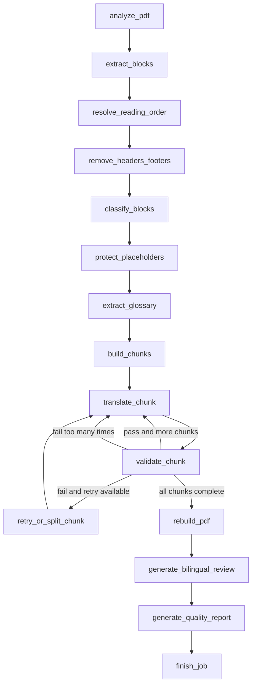

# pdf-scidoc-translator

Local, CLI-first English → Russian translator for large text-based scientific PDFs.

The MVP is intentionally deterministic: LangGraph controls the state-machine workflow, SQLite stores durable job state, and local LLM calls are isolated to explicit translation/checking nodes. The LLM never chooses the workflow.

## Current MVP

Implemented first-deliverable capabilities:

- uv-based Python 3.12 project
- Typer CLI
- PyMuPDF PDF intake
- scanned/empty-text PDF rejection with the required MVP message
- block extraction into SQLite
- basic reading-order resolution
- repeated header/footer marking
- deterministic block classification
- placeholder protection and restoration
- basic chunking
- llama.cpp OpenAI-compatible `/chat/completions` translation call
- deterministic placeholder/Russian/LLM-comment validation
- checkpoint/resume-friendly SQLite persistence
- simple `translated_ru.txt` output

Planned next extensions: glossary CSV workflow, readable PDF rebuild, bilingual review HTML, QA report HTML, richer retry/splitting, optional meaning/terminology checks, and Russian academic post-editing.

## Requirements

- Python 3.12+
- [uv](https://docs.astral.sh/uv/)
- A local llama.cpp server exposing an OpenAI-compatible API, for example:

```bash
llama-server --host 127.0.0.1 --port 8888 --model ./model.gguf
```

## Setup

```bash
uv sync --dev
```

## Run

```bash
uv run python -m app translate \
  --input book.pdf \
  --output ./out \
  --backend llama_cpp \
  --base-url http://localhost:8888/v1
```

Or via the installed script:

```bash
uv run pdf-scidoc-translator translate --input book.pdf --output ./out --base-url http://localhost:8888/v1
```

For slower local models, increase the read timeout and optionally reduce chunk size:

```bash
uv run python -m app translate \
  --input book.pdf \
  --output ./out \
  --base-url http://localhost:8888/v1 \
  --timeout 600 \
  --max-chunk-chars 2500 \
  --max-translation-attempts 3
```

Transport errors such as local LLM timeouts are saved as chunk validation errors and retried up to `--max-translation-attempts`. The SQLite state in the output directory is reused so interrupted jobs can continue from persisted blocks/chunks/translations.

If the PDF is scanned or has insufficient selectable text, the command fails clearly:

```text
This PDF appears to be scanned or has insufficient selectable text. OCR is not supported in MVP.
```

## Outputs in MVP

Inside `--output`:

- `project_state.sqlite` — durable job state
- `translated_ru.txt` — concatenated Russian translation or draft export
- `translated_ru.pdf` — readable reflow draft PDF when export/final output runs
- `glossary.csv` — deterministic candidate glossary

If translation is interrupted, generate a partial draft from saved SQLite state:

```bash
uv run pdf-scidoc-translator export --output ./out
```

Missing chunks are marked visibly in the draft PDF/text by default.

Future outputs:

- `bilingual_review.html`
- `quality_report.html`

## Architecture



SQLite stores the actual job data after each important result so the pipeline can be resumed and audited.

## Development

```bash
uv run ruff check .
uv run pytest
```
